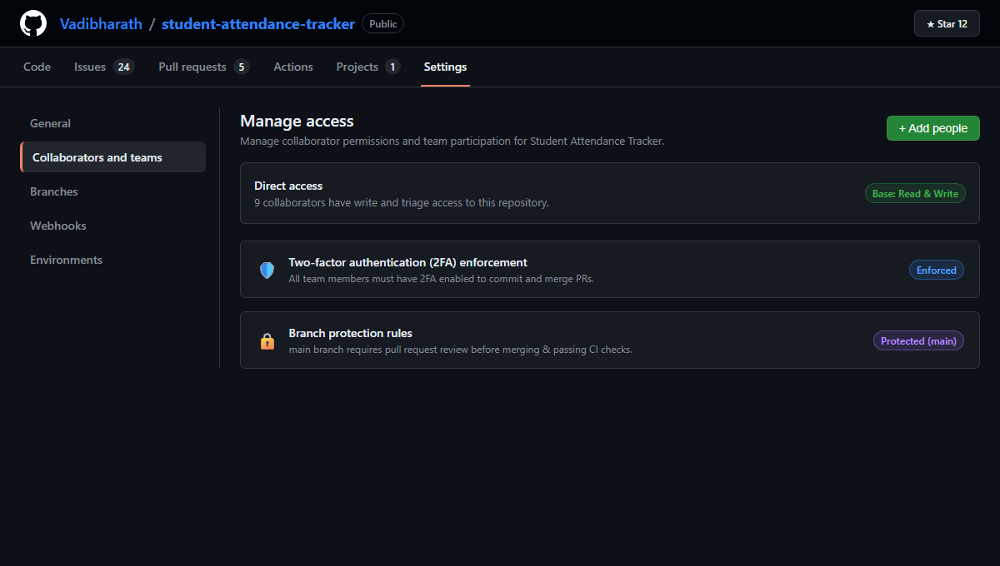
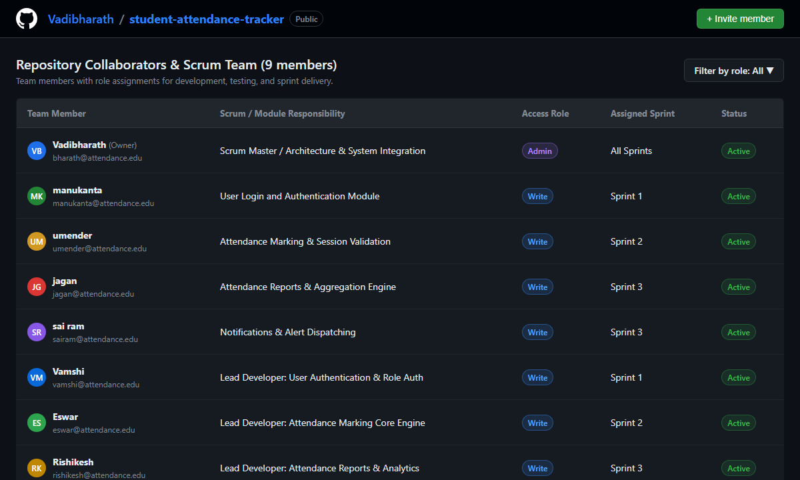
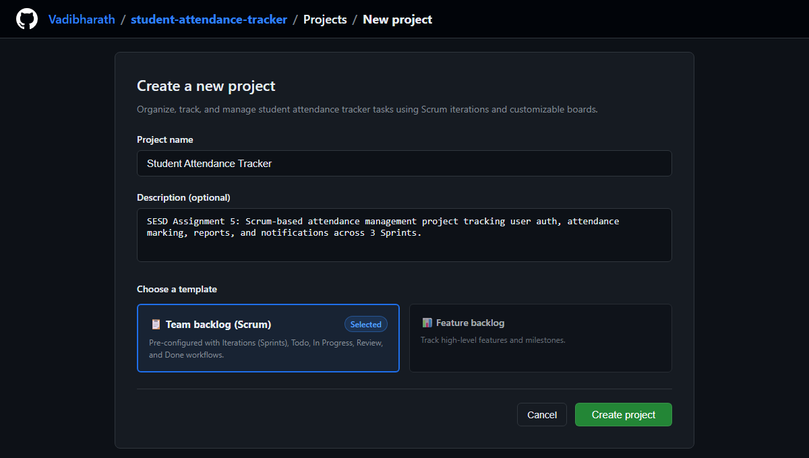
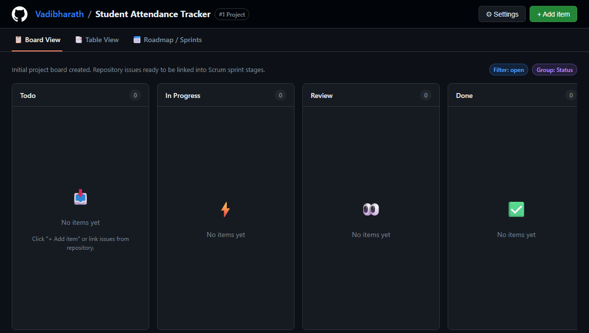
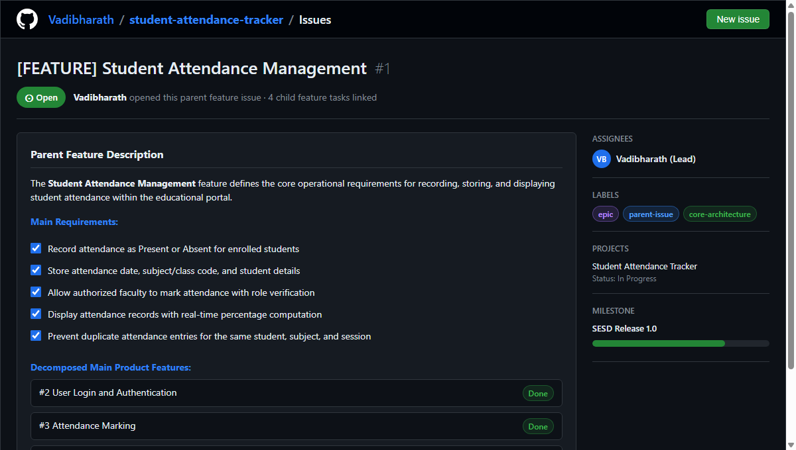
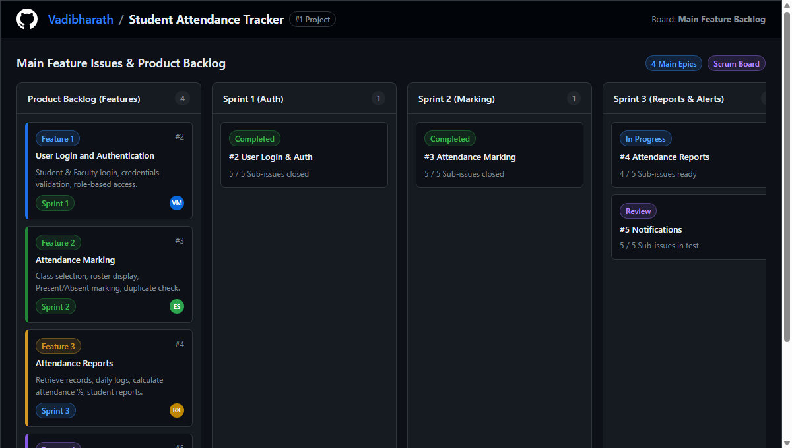
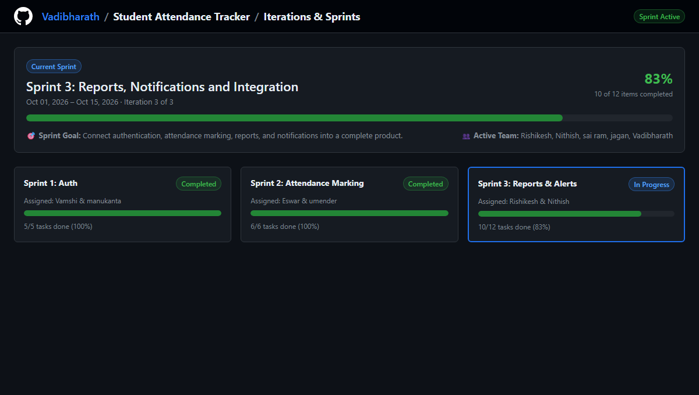
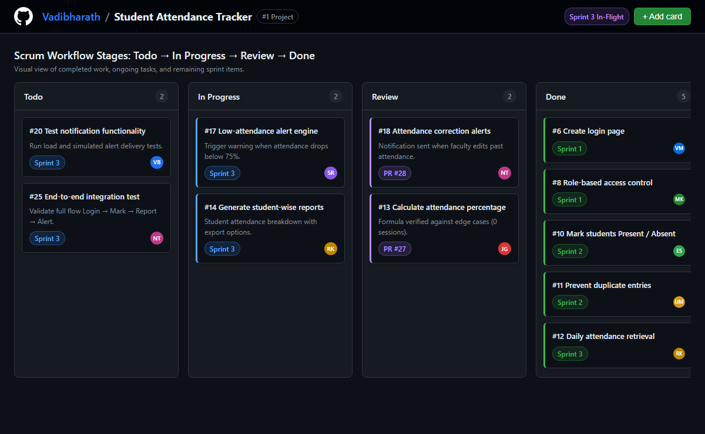

# 📊 Student Attendance Tracker
### Software Engineering & System Design (SESD) — Assignment 5

[](https://github.com/Vadibharath/student-attendance-tracker)
[](https://github.com/Vadibharath/student-attendance-tracker)
[](https://github.com/Vadibharath/student-attendance-tracker)

A modern, responsive, Scrum-managed web application for institutional attendance tracking, complete with role-based authentication, real-time marking, automated percentage calculations, shortage alerts (`<75%`), and comprehensive documentation.

---

## 🎯 Product Flow

```
[ Login ]  ──►  [ Mark Attendance ]  ──►  [ View Attendance Reports ]  ──►  [ Receive Notifications ]
```

---

## 👥 Scrum Team & Responsibilities

| Team Member | Module / Role | Sprint Focus |
|:---|:---|:---|
| **Vadibharath** | Scrum Master & Architecture Lead | Repository Setup & Integration |
| **manukanta** | User Login and Authentication Module | Sprint 1 |
| **umender** | Attendance Marking & Session Validation | Sprint 2 |
| **jagan** | Attendance Reports & Aggregation Engine | Sprint 3 |
| **sai ram** | Notifications & Alerts Dispatching | Sprint 3 |
| **Vamshi** | Lead Developer: User Authentication & Roles | Sprint 1 |
| **Eswar** | Lead Developer: Attendance Marking Core Engine | Sprint 2 |
| **Rishikesh** | Lead Developer: Reports & Statistical Analytics | Sprint 3 |
| **Nithish** | Lead Developer: Notifications & System Integration | Sprint 3 |

---

## 📋 Scrum Development Lifecycle

```
Product Backlog  ──►  Sprint Planning  ──►  Sprint Execution  ──►  Daily Scrum  ──►  Development  ──►  Sprint Review  ──►  Sprint Retrospective  ──►  Next Sprint
```

### Sprint Increments
* **Sprint 1 (Auth)**: Login page design, credential validation, role routing (`Faculty` vs `Student`).
* **Sprint 2 (Marking)**: Subject selection (`CS301`, `CS201`, `CS302`, `CS303`), roster display, Present/Absent toggles, **duplicate entry prevention**.
* **Sprint 3 (Reports & Notifications)**: Cumulative percentage calculations, shortage alerts (`<75%`), update/correction notifications, CSV export, integrated delivery.

---

## 📁 Repository Structure

```
├── index.html                                        # Live Interactive Attendance Tracker Portal
├── style.css                                         # Design System tokens & glassmorphic styles
├── app.js                                            # Application logic, duplicate prevention, state engine
├── report.html                                       # Standalone printable & PDF-ready 11-page assignment report
├── SESD_Assignment_5_Student_Attendance_Tracker.docx  # Word document ready for college submission
├── SESD_Assignment_5_Student_Attendance_Tracker.pdf   # High-resolution PDF document (all 11 pages)
├── screenshots/                                      # 10 High-resolution GitHub workflow screenshots
│   ├── page1_collaboration_settings.png
│   ├── page1_team_members.png
│   ├── page2_create_project.png
│   ├── page2_initial_board.png
│   ├── page3_parent_feature_issue.png
│   ├── page3_main_features_board.png
│   ├── page5_notifications_parent_issue.png
│   ├── page5_notification_sub_issues.png
│   ├── page6_current_iteration.png
│   └── page6_project_board_status.png
├── build_assignment_docx.py                          # Script to regenerate DOCX
├── generate_screenshots.py                           # Headless screenshot capture script
└── README.md                                         # Project documentation
```

---

## 🖼️ GitHub Collaboration & Scrum Previews

### 1. Repository Collaboration & Team Setup



### 2. GitHub Project & Initial Scrum Board



### 3. Feature Backlog & Decomposition



### 4. Active Iteration & Project Board Workflow



---

## 🚀 Quick Start

1. **Launch the Live Application**:
   Open `index.html` directly in any modern web browser or serve via:
   ```bash
   python -m http.server 8000
   ```
2. **View or Print Assignment 5 Report**:
   * Open `report.html` and press `Ctrl + P` to save as PDF.
   * Or open `SESD_Assignment_5_Student_Attendance_Tracker.pdf` directly.
   * Open `SESD_Assignment_5_Student_Attendance_Tracker.docx` in Microsoft Word.

---

## 🎓 Academic Course Details
* **Course**: Software Engineering & System Design (SESD)
* **Assignment**: Assignment – 5
* **Repository**: [Vadibharath/student-attendance-tracker](https://github.com/Vadibharath)
